# arsApps 操作説明書

事務所内で使う社内ポータル「arsApps」の使い方です。
※ 現在はサンプル版です。データはそれぞれのパソコン・スマホのブラウザ内に保存され、他の端末とは共有されません。

最終更新：2026-11-02

---

## 目次
1. [ログイン](#1-ログイン)
2. [トップページ](#2-トップページ)
3. [案件予定表](#3-案件予定表)
   - [画面の見方](#31-画面の見方)
   - [表示の切り替え（週・月・今日）](#32-表示の切り替え週月今日)
   - [案件を登録する](#33-案件を登録する)
   - [案件を編集・削除する](#34-案件を編集削除する)
   - [繰り返し（定期案件・固定業務）](#35-繰り返し定期案件固定業務)
   - [複数台の案件](#36-複数台の案件)
   - [ドラッグで日付・担当を変える](#37-ドラッグで日付担当を変える)
   - [メモカード](#38-メモカード)
   - [休暇の登録](#39-休暇の登録)
   - [案件の検索・絞り込み](#310-案件の検索絞り込み)
4. [ドライバー管理](#4-ドライバー管理)
5. [請求先管理](#5-請求先管理)
6. [請求・支払管理](#6-請求支払管理)
7. [車両管理](#7-車両管理)
8. [よくある質問](#8-よくある質問)
9. [更新履歴](#9-更新履歴)

---

## 1. ログイン

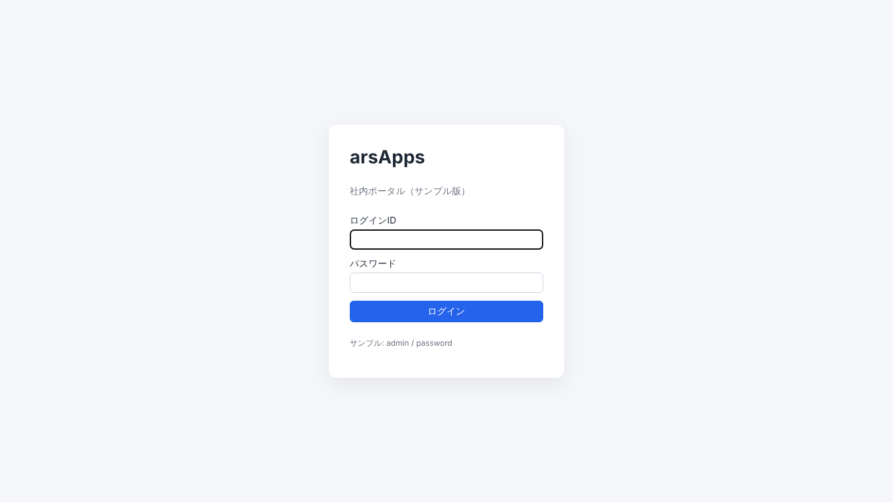

- ログインIDとパスワードを入力して「ログイン」を押します。
- サンプル版のログイン情報：ID `admin` ／ パスワード `password`
- 画面右上の「ログアウト」でログアウトできます。ブラウザを閉じると自動でログアウトします。

## 2. トップページ

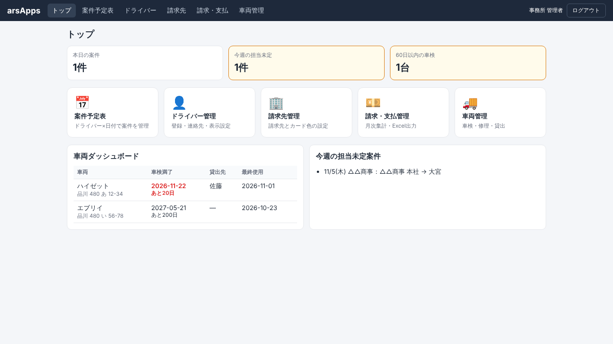

- 上段：本日の案件数、今週の担当未定件数、60日以内に車検が来る車両の台数
- 中段：各機能へのボタン
- 下段：車両ダッシュボード（車検満了日・貸出先・最終使用日）と、今週の担当未定案件の一覧
- 画面上部のメニューからも各機能に移動できます。

---

## 3. 案件予定表

### 3.1 画面の見方

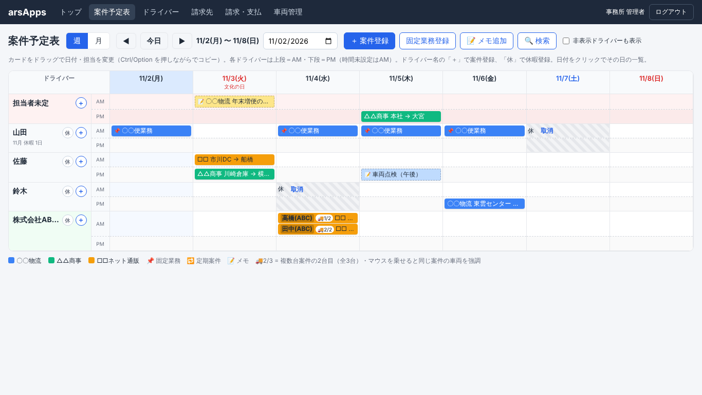

- **縦軸がドライバー、横軸が日付**です。
- 各ドライバーの行は **上段＝AM／下段＝PM** の2段に分かれています。
  - 積み時間（なければ降ろし時間）が12:00以降の案件はPMの段に入ります。
  - 時間を設定していない案件はAMの段に入ります。
  - 各段の中は、時間の早い順に上から並びます。
- **一番上の行は「担当者未定」**です。担当が決まっていない案件はここに入ります。
- **委託会社**は会社ごとに1行にまとめて表示し、カードの左端に個人の表示名が出ます。
- **社員**は名前の下に「〇月 休暇 〇日」と、表示中の月の休暇日数が出ます。
- **日付の見出し**：今日は青背景、土曜は青字、日曜・祝日は赤字です。祝日は祝日名も表示されます。
- ドライバー名の右のボタン
  - **「休」**：休暇登録（[3.9](#39-休暇の登録)）
  - **「＋」**：そのドライバーを担当者にして案件登録
- ドライバー名が長い場合は「…」で省略されます。マウスを乗せると全体が見えます。

**カードの見方**

| 表示 | 意味 |
|---|---|
| カードの色 | 請求先の色（カードごとに色を指定した場合はその色） |
| 📌 | 固定業務 |
| 🔁 | 定期案件 |
| 🚚2/3 | 複数台案件の2台目（全3台） |
| 📝（点線の枠） | メモカード |
| 「積み地 → 降ろし地」 | 通常の案件 |
| 積み地の文字だけ | 降ろし地が空欄の案件（「〇〇便業務」など） |

- カードにマウスを乗せると、請求先・時間・行先・備考が表示されます。
- 複数台案件のカードにマウスを乗せると、同じ案件の他の車両のカードが黒枠で強調されます。
- 日付の見出しをクリックすると、その日の予定一覧（時間順）が開きます。
- 普段は表示しない設定のドライバーも、その週に案件があれば表示されます。全員を表示したいときは「非表示ドライバーも表示」にチェックを入れます。
- 行の並び順は「ドライバー管理」画面で変更できます（[4](#4-ドライバー管理)）。

### 3.2 表示の切り替え（週・月・今日）

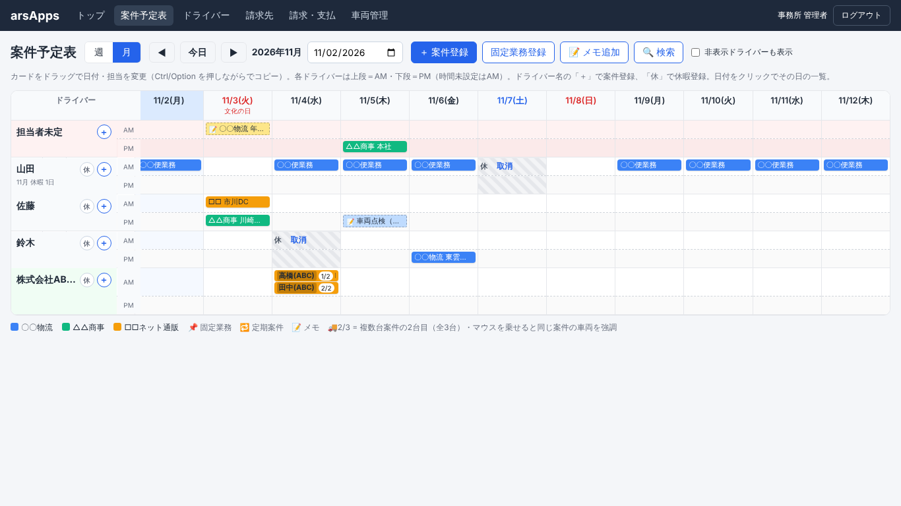

- **「週」「月」ボタン**：1週間表示と1か月表示を切り替えます。月表示は横にスクロールして見ます。月表示のカードには積み地だけが表示されます。
- **◀ ▶**：前の週（月）、次の週（月）へ移動します。
- **「今日」**：今日を含む週（月）に戻り、今日の列が見える位置までスクロールします。
- **日付欄**：日付を選ぶと、その日を含む週（月）に移動します。

### 3.3 案件を登録する

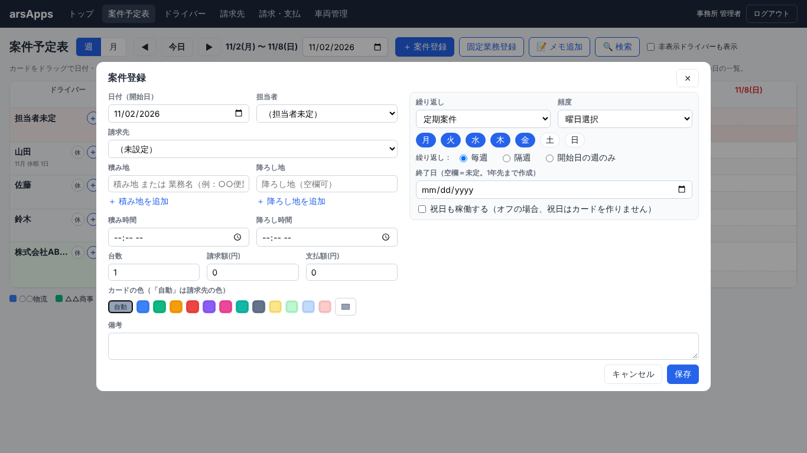

登録画面は次のどれかで開きます。
- 画面上部の「＋ 案件登録」
- ドライバー名の右の「＋」（そのドライバーが担当者に入った状態）
- 予定表の空いているマスをクリック（その日・そのドライバーが入った状態）
- 「ドライバー管理」画面の「案件作成」

| 項目 | 説明 |
|---|---|
| 日付 | 案件の日付。繰り返しの場合は開始日 |
| 担当者 | 未定のままでも登録できます（担当者未定の行に入ります） |
| 請求先 | 「請求先管理」で登録した請求先から選びます |
| 積み地 | 積み地、または「〇〇便業務」のような業務名。「＋ 積み地を追加」で複数入力できます |
| 降ろし地 | 空欄でも登録できます。「＋ 降ろし地を追加」で複数入力できます |
| 積み時間・降ろし時間 | カードには表示されません。並び順とAM/PMの振り分けに使います |
| 台数 | 2台以上にすると、台数分のカードを作ります（[3.6](#36-複数台の案件)） |
| 請求額・支払額 | 複数台の場合は1台あたりの金額 |
| カードの色 | 「自動」は請求先の色。色を選ぶとそのカードだけその色になります。右端のバーで好きな色も選べます |
| 繰り返し | 単発／定期案件／固定業務（[3.5](#35-繰り返し定期案件固定業務)） |
| 備考 | 自由メモ（カードにマウスを乗せると表示） |

- 積み地（または業務名）は必須です。
- 担当者が休暇の日に登録しようとすると、確認のメッセージが出ます。

### 3.4 案件を編集・削除する

- カードをクリックすると編集画面が開きます。
- 繰り返しの案件では、変更の反映範囲を選べます。
  - **この日のみ**：その日のカードだけ変更します（当日の担当変更など）。
  - **この日以降すべて**：その日以降の同じシリーズのカードをまとめて変更します。
- **削除**：画面左下の「削除」ボタンで削除します。反映範囲の選択は削除にも使われます。
- 日付だけは、常にその日のカードだけが変わります。

### 3.5 繰り返し（定期案件・固定業務）

- **定期案件（🔁）**：期間限定の定期案件などに使います。
- **固定業務（📌）**：毎日固定の役割など、ずっと続く業務に使います。画面上部の「固定業務登録」ボタンで開くと、最初から固定業務・月〜金が選ばれています。

| 設定 | 説明 |
|---|---|
| 頻度 | 毎日／曜日選択 |
| 曜日 | 曜日選択のとき、月〜日から選びます（青が選択中） |
| 繰り返し | 毎週／隔週／開始日の週のみ |
| 終了日 | 空欄の場合は1年先までカードを作ります |
| 祝日も稼働する | チェックを外すと、祝日にはカードを作りません |

**編集画面での繰り返し設定の変更**
- **種類だけ変える**（定期案件 ⇔ 固定業務）：そのシリーズのカードすべての種類が変わります。
- **頻度・曜日・終了日を変える**：編集した日より後のカードを、新しい設定で作り直します。
- **単発に戻す**：編集した日より後のカードを削除し、その日だけの案件にします。
- 作り直しになるときは、保存前に注意書きが出ます。その日より後に個別で変更した内容（担当の差し替えなど）はリセットされるので注意してください。
- 単発の案件を「定期案件」「固定業務」に変えることもできます。

### 3.6 複数台の案件

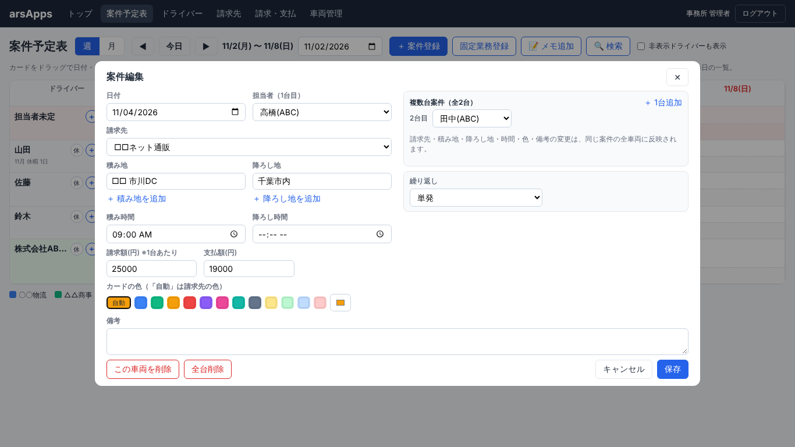

- 登録時に台数を2以上にすると、台数分のカードを作ります。
- 登録画面で選んだ担当者は1台目になります。2台目以降は「担当者未定」の行に入るので、ドラッグか編集画面で割り当てます。
- 編集画面の右上で、各車両の担当者の変更と「＋ 1台追加」ができます。
- 請求先・積み地・降ろし地・時間・色・備考を変えると、同じ案件の全車両に反映されます。
- 削除は「この車両を削除」（その1台だけ）と「全台削除」から選べます。

### 3.7 ドラッグで日付・担当を変える

- カードをドラッグして、別の日・別のドライバーのマスに落とすと移動します。
- **Ctrl（Macは Option）を押しながら**ドラッグすると、移動ではなくコピーになります。
- 委託会社の行に、その会社以外の人のカードを落とすと、誰に割り当てるか選ぶ画面が出ます。
- 休暇の人のマスに案件を落とすと、確認のメッセージが出ます。
- AM・PMのどちらの段に落としても、時間は変わりません。カードは時間に応じた段に表示されます。時間を変えるときは編集画面で直します。
- スマホではドラッグできません。カードをタップして編集画面で日付・担当を変えてください。

### 3.8 メモカード

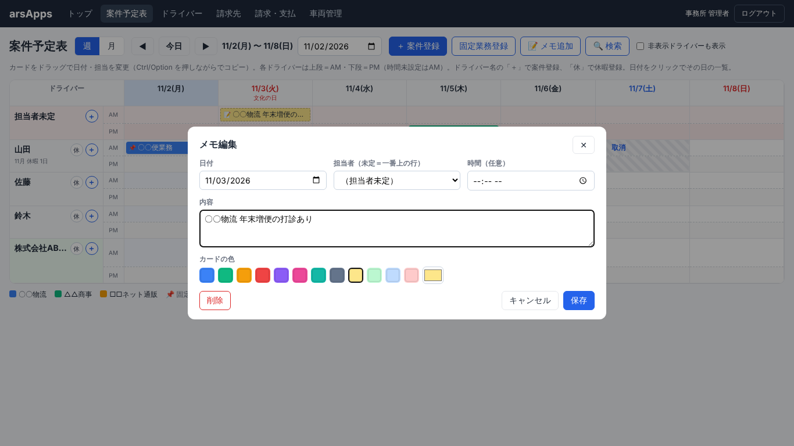

- 画面上部の「📝 メモ追加」で、案件ではないメモ用のカードを作れます。
- 項目：日付、担当者（未定の場合は一番上の行に表示）、時間（任意）、内容、色
- 点線の枠のカードで表示されます。クリックで編集・削除できます。
- 案件と同じようにドラッグで移動、Ctrl（Option）＋ドラッグでコピーできます。
- 請求・支払の集計には含まれません。

### 3.9 休暇の登録

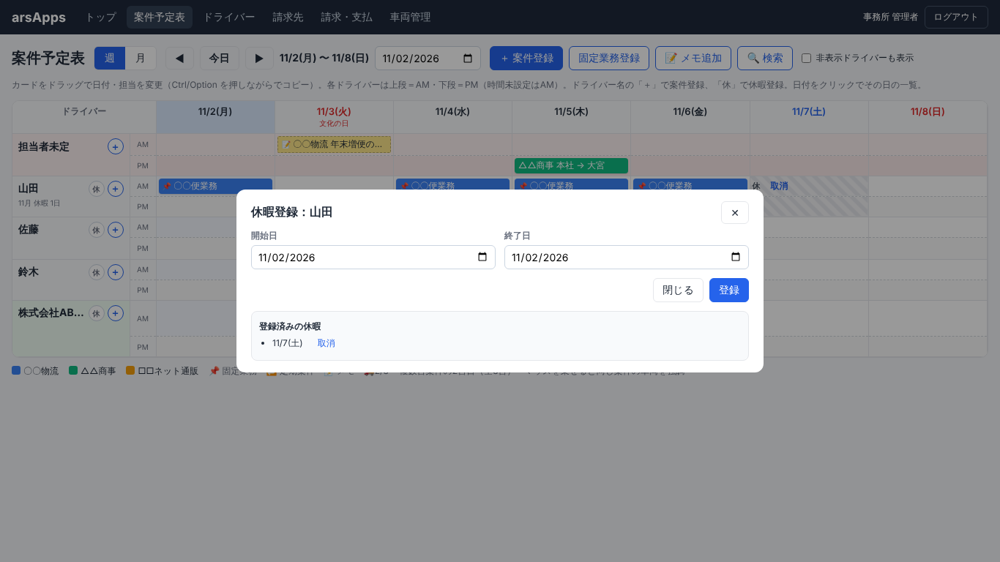

- ドライバー名の右の **「休」** を押すと、そのドライバーの休暇登録画面が開きます。
  - 委託会社の行の「休」では、会社のドライバーから選びます。
- 開始日と終了日を選んで「登録」を押します（1日だけの場合は同じ日付）。
- **案件が割り振られている日には休暇を登録できません。** 先に案件の担当を変更してください。メモカードがある日は登録できます。
- 休暇の日は、マスの左上に「休」と表示され、斜線の背景になります。委託会社の行では「休 高橋(ABC)」のように名前も表示されます。
- 取り消しは、マスの「取消」か、休暇登録画面の「登録済みの休暇」一覧の「取消」で行います。
- 社員は、名前の下に表示中の月の休暇日数が出ます。

### 3.10 案件の検索・絞り込み

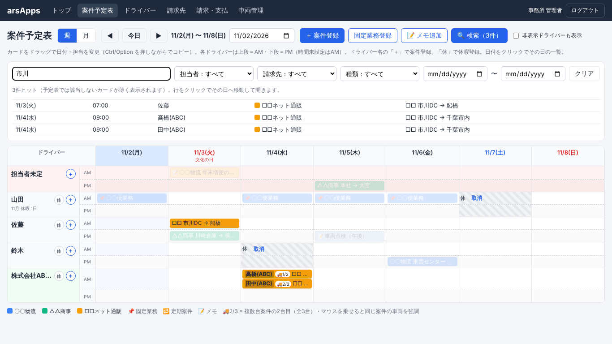

- 画面上部の **「🔍 検索」** を押すと検索欄が開きます。
- **キーワード**：積み地・降ろし地・備考・請求先名・担当者名・メモの内容から探します。
- **絞り込み**：担当者（「担当者未定」も選べます）、請求先、種類（単発・定期案件・固定業務・メモ）、期間
- 条件に合う案件・メモが一覧で表示されます（全期間が対象。先頭200件まで）。行をクリックすると、その日に移動して編集画面が開きます。
- 検索中は、予定表で条件に合わないカードが薄く表示されます。
- 「クリア」で条件をすべて解除します。検索中は検索ボタンに件数が表示されます。

---

## 4. ドライバー管理

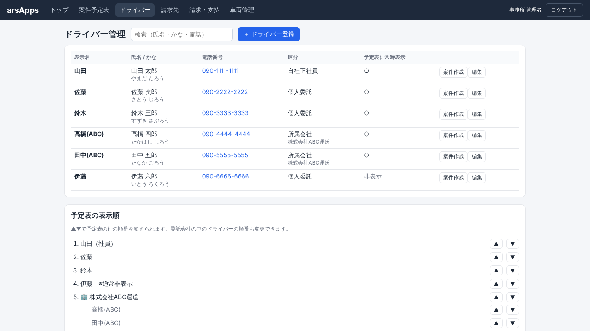

**ドライバーの登録・編集**
- 「＋ ドライバー登録」で登録、各行の「編集」で変更・削除します。

| 項目 | 説明 |
|---|---|
| フルネーム・読み仮名・電話番号 | ドライバー管理表として保存（予定表には出ません） |
| 表示名 | 予定表に表示する名前 |
| 区分 | 個人委託／所属会社／自社正社員 |
| 所属会社 | 区分が「所属会社」のとき選びます |
| 予定表に常に表示する | オフにすると、案件がない週は予定表に出ません |

- ドライバーを削除すると、その人の案件は「担当者未定」になります。
- 各行の「案件作成」で、そのドライバーを担当者にして案件を登録できます。
- 電話番号をタップすると電話がかけられます（スマホ）。

**予定表の表示順**
- ▲▼ボタンで、予定表の行の並び順を変えられます。
- 委託会社の中のドライバーの並び順も、会社名の下の▲▼で変えられます。

**委託会社**
- 画面下の「委託会社」で会社を追加します。

## 5. 請求先管理

- 請求先の追加・名前の変更・削除ができます。
- 各請求先の色を変えると、予定表のカードの色（「自動」のカード）に反映されます。
- 請求先を削除すると、その請求先の案件は「請求先未設定」になります。

## 6. 請求・支払管理

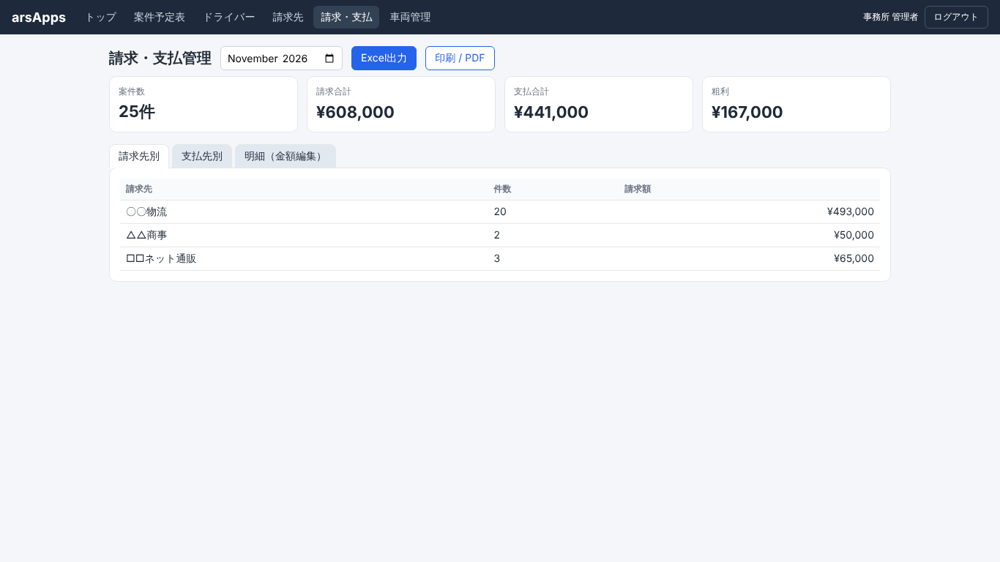

- 月を選ぶと、その月の案件数・請求合計・支払合計・粗利が表示されます。
- **請求先別**：請求先ごとの件数と請求額
- **支払先別**：ドライバーごとの件数と支払額（所属会社のドライバーは会社単位でまとめます）
- **明細（金額編集）**：案件ごとの請求額・支払額を直接修正できます。
- **Excel出力**：明細・請求先別・支払先別と、請求先ごとの請求書下書きのシートを出力します。Excelで自由に編集できます。
- **印刷 / PDF**：表示中の画面を印刷します。印刷先で「PDFに保存」を選ぶとPDFになります。
- メモカードは集計に含まれません。

## 7. 車両管理

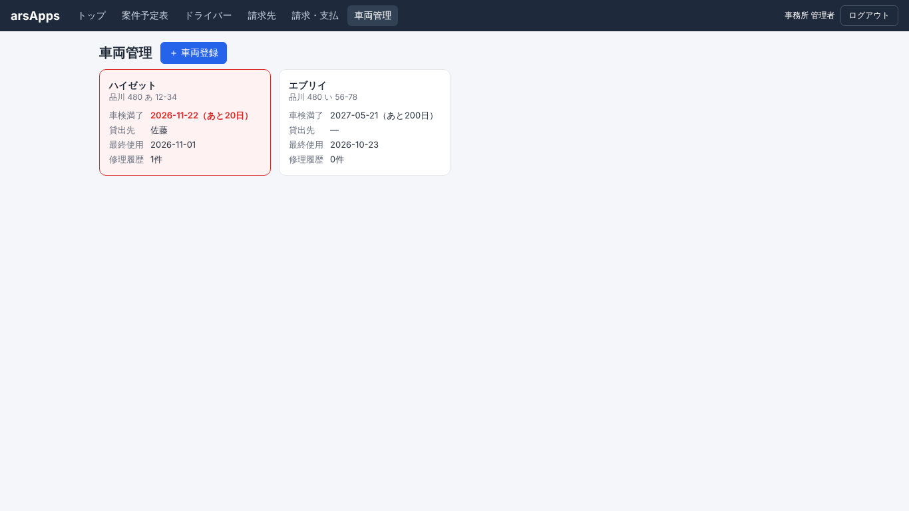

- 「＋ 車両登録」で登録、カードをクリックで編集・削除します。
- 項目：車名、ナンバー、車検満了日、貸出先、最終使用日（「今日」ボタンで今日の日付を入力）、修理履歴（日付・内容・費用）
- 車検まで60日以内はオレンジ、30日以内は赤で表示されます。トップページにも表示されます。

---

## 8. よくある質問

**Q. 入力したデータが他のパソコンやスマホで見られない**
A. サンプル版は、データをそれぞれのブラウザの中に保存しています。本番版では共有できるようにする予定です。

**Q. データを最初のサンプルの状態に戻したい**
A. ブラウザで `F12` →「Application（アプリケーション）」→「Local Storage」→ `arsapps-db-v2` を削除して、ページを再読み込みします。

**Q. 休暇を登録しようとしたら「案件が割り振られているため登録できません」と出た**
A. その日に担当の案件があります。先に案件をドラッグするか編集画面で、担当を別の人か「担当者未定」に変えてから休暇を登録してください。

**Q. 定期案件の1日だけ担当を変えたい**
A. カードをドラッグするか、編集画面で反映範囲を「この日のみ」にして担当者を変えます。

**Q. 画面が古いまま変わらない**
A. `Ctrl + Shift + R`（Macは `Cmd + Shift + R`）で再読み込みしてください。

---

## 9. 更新履歴

| 日付 | 内容 |
|---|---|
| 2026-11-02 | ドライバーの表示順の変更、案件編集画面をPCでスクロールなしで表示、社員の月間休暇日数の表示、ドライバー欄からの休暇登録（ヘッダーの休暇登録ボタンを削除）、案件がある日の休暇登録を禁止、「休」をマスの左上に表示、案件の検索・絞り込み、説明書を作成 |
| 2026-11-01 | カードのカーソルを指の形に、AM/PM表記、ドライバー欄の「＋」、カードの色指定、メモカード、「固定業務登録」に名称変更、編集画面で繰り返し設定を変更可能に、ドライバー名を1行表示 |
| 2026-10-27 | AM/PMの2段表示、時間順の並び、カードの縮小、「今日」ボタン、月表示、積み・降ろし時間、曜日選択の繰り返し、業務名だけの案件、複数台案件のカード分割 |
| 2026-10-25 | サンプル版を作成 |
